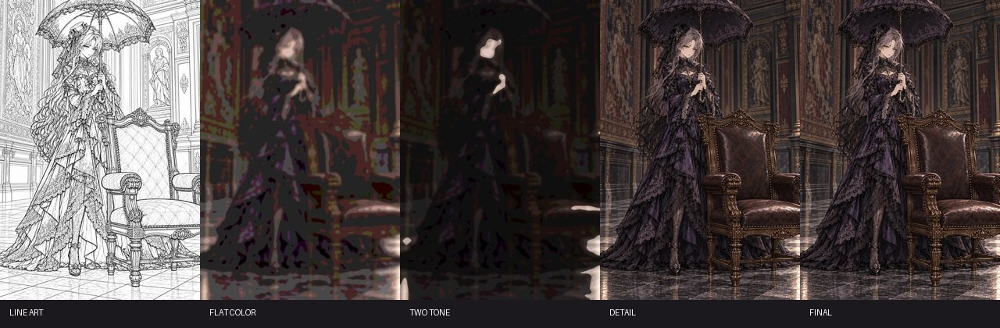

# 动漫成图 → 20 层可上色 PSD

从左到右：**线稿** → **平涂底色** → **二分** → **细化** → **成稿**。
左边那张白底线稿就是本流水线的输出——纯白底、纯黑平滑线、连续不断线，可以直接拿去上色或做涂色本。

## 一句话

一张二次元成图进去，出来两样东西：**白底 2.5px 平滑线稿** + **约 20 层可上色 PSD**
（8 档明度底色 + 皮肤 + 高光 3 层 + 阴影 3 层 + 冷暖调色 + 线稿/草稿/背景）。

## 适合谁

- 拿到 AI 生成稿，想要一份能改色、能分层的 PSD 交付；
- 需要"线稿 + 平涂分层"的教学素材、涂色本、周边打样；
- 想在本地把「出图 → 抠图 → 线稿 → 分层 → 组装」整条链路跑通，不依赖云端服务。

不适合厚涂/水彩/油画笔触（8 档明度切分会脏）、复杂实景背景，也不做逐帧动画。
详见 [SKILL.md](./SKILL.md) 的「不适用」。

## 五步

| 步 | 做什么 | 脚本 |
|---|---|---|
| 1 | ComfyUI + NoobAI-XL-Vpred 出 1024×1536 竖版成图（可选） | `scripts/gen_illustration.py` |
| 2 | rembg + isnet-anime 本地抠图，深色服装/深背景也稳 | `scripts/matting_local.py` |
| 3 | Canny 边缘 + 矢量 Chaikin 平滑 → 白底 2.5px 连续线稿 | `scripts/lineart_canny.py`、`scripts/make_lineart_v2.py`、`scripts/smooth_line.py` |
| 4 | 按 8 档明度 + 皮肤 + 高光/阴影/冷暖拆分图层 | `scripts/layers_20.py` |
| 5 | Photoshop COM 置入图层、设混合模式与不透明度、保存 PSD | `scripts/build_psd.py`、`scripts/ps_conn.py` |

## 脚本清单

| 文件 | 作用 |
|---|---|
| `scripts/gen_illustration.py` | ComfyUI txt2img，CFG=7 / DPM++ 2M Karras |
| `scripts/matting_local.py` | 本地 rembg（isnet-anime）抠 alpha，不出网 |
| `scripts/make_lineart_v2.py` | 线稿 v2：人物/背景双阈值 Canny + 矢量平滑，输出透明黑线与白底稿 |
| `scripts/smooth_line.py` | 骨架 → 矢量路径 → 样条平滑 → 超采样抗锯齿（解决像素楼梯感） |
| `scripts/layers_20.py` | 约 20 层分层核心，7 组结构，输出各层 PNG |
| `scripts/build_psd.py` | PSD 组装：动态读各层、设混合模式、存到 `OUT_DIR` |
| `scripts/ps_conn.py` | COM 连接健壮化（PS 冷启动/模态框时重试） |
| `references/workflow_notes.md` | 实操记录：参数、返工点、失败样例与判断依据 |

## 起点

1. 读 [SKILL.md](./SKILL.md) 的 When / What，确认成图属于平涂或赛璐珞风；
2. 只想要线稿：直接 `python scripts/make_lineart_v2.py <成图> <抠图alpha>`；
3. 要整份 PSD：按 `gen → matting → lineart → layers → build_psd` 顺序跑，路径用 `IN_DIR` / `OUT_DIR` 控制；
4. 依赖见 [../docs/illustration-requirements.txt](../docs/illustration-requirements.txt)。

## 边界

- 前提是干净色块，笔触重的图会被切脏；
- 主体边界不清晰（复杂实景背景）时抠图与线稿检测都会失败；
- 单图交付，不做帧间一致性。
