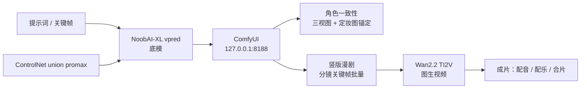

# ComfyUI 绘画管线

这份不是"怎么装 ComfyUI"，而是一份**踩过坑之后的本地操作手册**：
哪些配方在 8GB 显存上真能跑、多少秒、什么参数、以及哪些做法看着合理但必失败。

## 一句话

本地 ComfyUI 的 API 调用、模型下载（国内镜像）、ControlNet 线稿上色、显存与节点配置、以及一整串"别再试了"的结论。

## 适合谁

- 已经有一台带独显的机器，想在本地跑出图/图生视频，不想付云端积分；
- 需要**角色一致性**（三视图 + 定妆图锚定）或**漫剧分镜批量**这种成套配方；
- 正在被 `LayerDiffuse` 的限制、`localhost` 被代理截胡、群像镜头崩脸这些问题卡住。

不适合无独显的机器，也不承诺同一 seed 跨版本可复现。详见 [SKILL.md](./SKILL.md) 的「不适用」。

## 手册里最省时间的几条

| 内容 | 结论 |
|---|---|
| 探活 | 必须先 `curl --noproxy "*"`。命令行设了 `http_proxy` 时，访问 8188 会拿到代理错误页，造成"COMFY_UP"假阳性 |
| NoobAI vpred | 832×1216 约 25s/张（RTX 4060 Laptop 8GB），默认 10 步 |
| ControlNet union promax | 线稿 → 上色约 35s/张 |
| 色 → 线稿 | NoobAI **做不到**，别在这上面耗时间；线稿走 LineartAnime 或 Canny + 矢量平滑 |
| LayerDiffuse | 已装但有硬限制，别当通用透明图层生成器 |
| 模型下载 | ModelScope 国内镜像约 26MB/s，不需要 VPN |
| 群像 / 小脸 | 5 人以上中景必糊，改侧后方视角；负面词会反噬，群像要拆掉 `extra people` |
| 空镜 / 小道具 | 容易崩成纯色或凭空长物体，改用后期合成，别死磕提示词 |

## 配方索引（都在 SKILL.md 里）

- **底模参数**：NoobAI-XL vpred 已验证参数段；
- **角色一致性**：三视图 + 定妆图锚定法、古装动漫三视图配方；
- **漫剧管线**：竖版分镜关键帧批量配方、5 秒镜头标准配方、竖版成片一键批量；
- **图生视频**：Wan2.2 TI2V 5B（15~60s / 49 帧 480×832）、10 秒长镜头（241 帧 448×768）；
- **写实关键帧**：Z-Image-Turbo 768×1344；
- **稳定性诊断**：区分「镜头抖」与「五官抖」，两个独立问题两套解法。

## 起点

1. 设好 `COMFY_ROOT`（默认 `D:\ComfyUI`，含 `ComfyUI/` 与 `python_embeded/`），启动后 `curl --noproxy "*" http://127.0.0.1:8188` 探活；
2. 抄 [SKILL.md](./SKILL.md) 里那段无代理 `api()` 封装提交 prompt，再轮询 `/history/<prompt_id>`；
3. 模型按手册的 ModelScope 镜像段下载，权重落在 `%COMFY_ROOT%\models\`；
4. 想省事就直接用现成配方段，别从零调参。

## 边界

- 8GB 显存档位的实测，纯 CPU 出图不划算；
- 采样器/模型/节点更新都会改变结果，跨版本不保证复现；
- 各权重许可不同，商用前自行确认。
