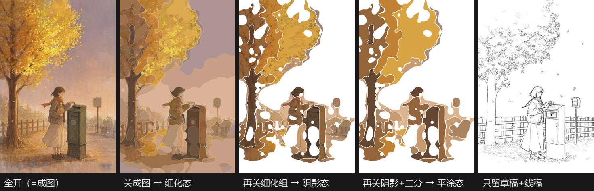

# 伪厚涂分层插画



同一张画，从左到右依次是：**全开（等于成品）** → 关掉"成图"层 → 再关"细化"组 → 再关"阴影 + 二分" → 只剩草稿与线稿。
不是把效果往上叠，而是从成品图**反解**出来的层级——所以每一层关掉，画面都真的会变。

## 一句话

给一句提示词或一张参考图，交付一份 **默认 19 图层（6 组 + 13 层）的 PSD**：
13 层全开时逐像素等于成品图，每层可单独关、可单独改，方便二次修改与客户校对。

层数、组名、层名、混合模式、不透明度都不是写死在成品里的——它们集中在
`assets/layers_template.py` 顶部的 `GROUP_ORDER` / `LAYERS` / `HIDDEN_BY_DEFAULT` 三张表，
`build_psd_template.py` 直接读这三张表去组装 PSD（见第 32–36 行），改表即改层级结构。
要加新效果层仍然要写生成逻辑，这里是**结构可调**，不是任意新效果的通用分层器。

## 适合谁

- 需要把 AI 出的厚涂/半厚涂稿做成**可编辑分层文件**交付的人（约稿、商用、印刷、二次修改）；
- 已有参考 PSD 的分层结构，要"照这个结构再做一张"；
- 想验证"这张图的分层是不是真的有用"——`make_preview_template.py` 会直接输出关层对比图。

不适合照片、3D 渲染、合成拼贴，也不适合需要几十层材质通道的交付。详见 [SKILL.md](./SKILL.md) 的「不适用」。

## 五步流程

```
草稿 → 线稿 → 上色 → 分图层 → 细化
```

分图层是核心：把 Photoshop 的混色模式（MULTIPLY / SCREEN / SOFT_LIGHT …）写成解析式，
从成品图逐层反推出「完整色 / 阴影 / 高光 / 边缘光 / 整体调色 / 背景」各层，再校验"全开是否逐像素等于成品"。

## 脚本清单

| 文件 | 作用 |
|---|---|
| `assets/comfy.py` | ComfyUI 客户端与工作流构造（出图侧） |
| `assets/prompts_example.py`、`assets/themes_example.json` | 六个主题的提示词与参数，画风锚段全系列复用 |
| `assets/gen_lineart3.py` | LineartAnime 直接抽线（连续闭合、贴合填色书参考） |
| `assets/gen_lineart30.py` | @2048 抽线 + 眼框内 Canny 补虹膜/瞳孔 |
| `assets/gen_lineart_cn.py` | ControlNet 结构引导 + NoobAI 重绘干净线稿（生成式，非像素抽取） |
| `assets/lineart_canny.py`、`assets/smooth_line.py` | Canny 三层线稿 + 矢量 Chaikin 平滑，统一 2.5px 黑线 |
| `assets/layers_template.py` | **分层核心**：成品图 → 13 层，含逐层校验 |
| `assets/layers_flat_qban.py` | Q 版平涂流量稿的分层变体（mean-shift + 颜色 kmeans） |
| `assets/build_psd_template.py` | 用 PS COM 把 13 个 PNG 组装成分组 PSD |
| `assets/make_preview_template.py` | 生成"分层预览"与"关层对比"两张验证图 |
| `assets/dewatermark.py` | 去出图平台右下角水印（inpaint + 镜像补丁融合） |
| `assets/ps_conn.py`、`assets/restart_ps.py` | COM 连接健壮化：PS 卡在模态框时自动重启并轮询 |

## 起点

1. 先读 [SKILL.md](./SKILL.md) 的「0. 图层结构」——19 层的名字、混合模式、不透明度都写死在那里，照抄即可；
2. 只想要分层、不需要出图：准备一张成品图，跑 `layers_template.py` + `build_psd_template.py`；
3. 环境要求：ComfyUI（出图/线稿）+ Photoshop（COM 组装），依赖见 [../docs/illustration-requirements.txt](../docs/illustration-requirements.txt)。

## 边界

- 默认 19 层；组名/层名/混合模式/不透明度可改，但要新增一类效果层仍需自己写生成逻辑；
- 写实材质、杂乱笔触会被压成色块，拆不出有意义的层；
- 目标机器必须有 Photoshop，否则只剩出图与配色脚本可用。
